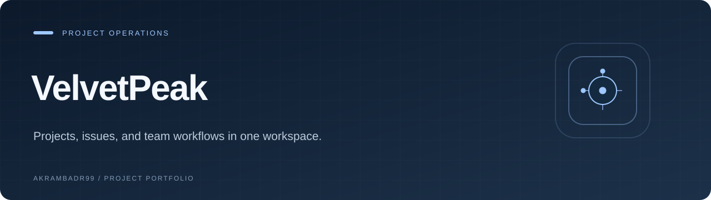
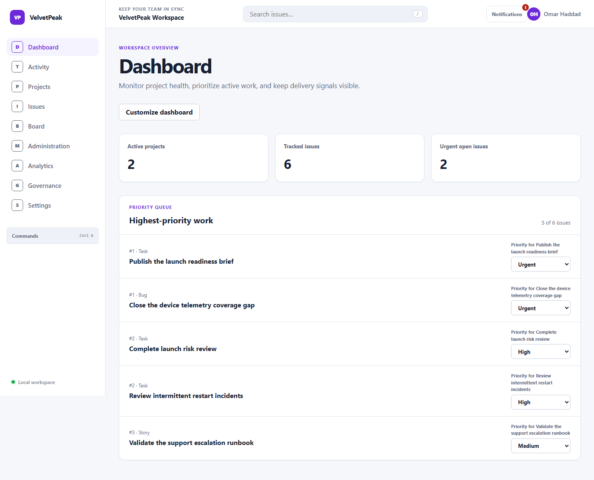

<p align="center">
  
</p>

<p align="center"><strong>Projects, issues, and team workflows in one workspace.</strong></p>

<p align="center"><a href="#overview">Overview</a> · <a href="#explore">Explore</a> · <a href="#getting-started">Getting started</a></p>

<p align="center"><code>React</code> · <code>TypeScript</code> · <code>Vite</code></p>

## Overview

**VelvetPeak** is a React and TypeScript workspace for project management, issue tracking, collaboration, and operational reporting.



*Actual application capture using local fixture data.*

## Explore

- Workspace dashboard
- Project ownership and workflows
- Issue search, filters, and bulk actions
- Kanban board
- Comments, mentions, and notifications
- Analytics and governance views

## Getting started

Node.js requirement: `>=20.19 <21`. Use the package manager specified in [package.json](package.json).

```bash
git clone https://github.com/Akrambadr99/VelvetPeak.git
cd VelvetPeak
npm ci
npm run dev
```

Open the URL printed by the development server.

### Development commands

| Command | Script defined by this project |
| --- | --- |
| `npm run dev` | `vite` |
| `npm run typecheck` | `tsc -b` |
| `npm run lint` | `eslint . --max-warnings 0` |
| `npm run test` | `vitest run` |
| `npm run test:e2e` | `playwright test` |
| `npm run build` | `npm run typecheck && vite build && node scripts/check-entry-budget.mjs` |

See the project guide below for browser installation and any service-specific setup.

## Project notes

This application shares the Atlas Ops / Taskora project foundation. It is presented as a related workspace variant, not as an independently originated codebase. Application data is served by the local in-memory gateway; browser preferences use local storage.

<details>
<summary><strong>Project guide, technical details, and existing documentation</strong></summary>

# VelvetPeak

VelvetPeak is an operations and project-management application for
projects, issues, workflow governance, collaboration, and operational analytics.
It is a single React application built with strict TypeScript, Vite, Node.js 20,
and npm.

## Requirements

- Node.js 20.19 or newer within the Node.js 20 release line
- npm 10

## Local development

```sh
npm ci
npm run dev
```

## Validation

```sh
npm run lint
npm run test
npm run test:coverage
npm run test:e2e
npm run typecheck
npm run build
```

`npm run test:e2e` starts the Vite development server and requires the Playwright
Chromium browser installed by `npx playwright install chromium`.

## Current product surfaces

- Configurable operational dashboard with authoritative issue, project, and
  analytics widgets
- Searchable project portfolio, deep-linked project context, lifecycle changes,
  leadership transfer, membership administration, and workflow configuration
- Issues workspace with URL-backed search, workflow-aware filters, sorting,
  pagination, configurable columns, cross-page selection, and bulk actions
- Permission-aware issue creation and editing with validation, optimistic
  updates, revision conflicts, rollback, and recovery
- Project Kanban with pointer movement and an equivalent keyboard workflow
- Issue comments, moderation, mentions, watchers, project subscriptions, and
  durable activity history
- Cancellation-aware global search, saved views, persisted preferences, command
  palette, and keyboard shortcuts
- Filtered notification inboxes, delivery preferences, optimistic updates, and
  concurrent mutation reconciliation
- Time-ranged analytics, workspace activity exploration, protected governance
  reporting, membership lifecycle management, and invitation provisioning

## Architecture

The repository separates React presentation and routing from feature-level query
orchestration, domain policy, and data access:

- `src/app` owns the route tree, application shell, providers, recovery
  boundaries, and page composition.
- `src/features` owns feature interactions and TanStack Query cache coordination.
- `src/domain` owns branded identifiers, entities, invariants, authorization
  policy, and lifecycle rules without depending on React.
- `src/data` owns deterministic clocks and generators, immutable snapshots, the
  versioned in-memory store, gateway capabilities, network simulation, request
  cancellation, conflict handling, and tracing.
- `src/components` contains reusable interaction primitives such as accessible
  modal dialogs and data tables.

Lint rules enforce these layer boundaries and prevent feature code from reaching
around the gateway into datastore internals.

## Self-contained runtime

Application data is served through a typed asynchronous gateway backed by an
in-memory versioned store. This keeps local development deterministic while
preserving cancellation, conflict, tracing, and error boundaries expected from
a production transport. Tests do not require credentials, a database, an
external API, or any third-party service. Browser preferences use local storage;
all authoritative application state remains behind the gateway boundary.

The in-memory gateway is an intentional product boundary for this private
frontend repository, not a claim of durable server persistence. Its contracts
can be implemented by a remote transport without coupling presentation code to
backend details.

## Test strategy

Vitest suites cover domain policy, deterministic data infrastructure, gateway
behavior, cache coordination, concurrency, and rendered user interactions.
Playwright exercises independent cross-feature journeys through the running
application, including keyboard and focus behavior. Coverage and a production
entry-bundle budget are part of the validation gate.

</details>

---

<p align="center"><a href="https://github.com/Akrambadr99?tab=repositories">Explore the portfolio</a></p>
